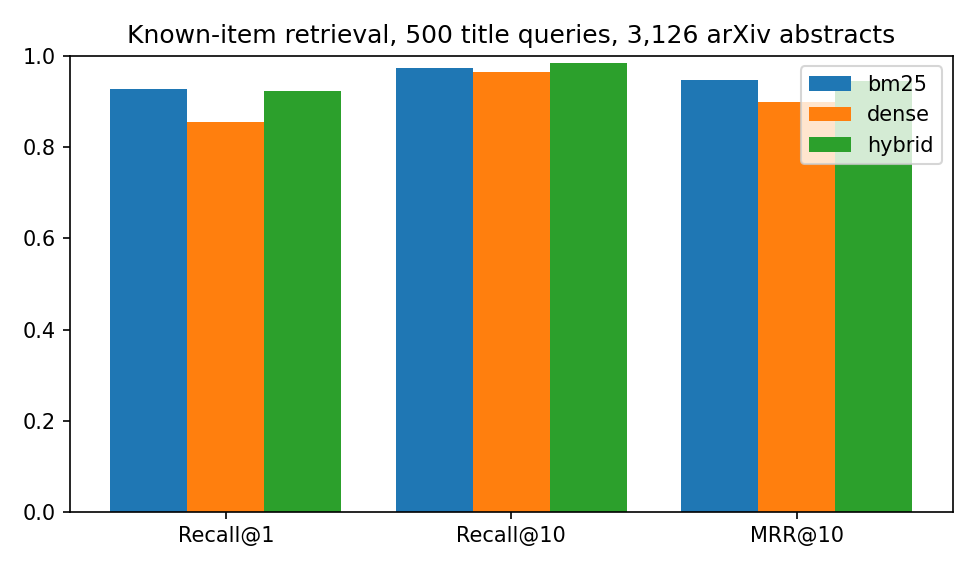

# arXiv RAG Search: hybrid paper search with evaluated, cited answers

> **Personal project.** Built independently in my own time with public data. It is not affiliated with, commissioned by, or derived from any employer, client or academic institution.

A small, production-shaped **retrieval-augmented generation (RAG)** service over 3,126 recent arXiv papers
(complex systems, adaptation & self-organization, information retrieval, statistical ML).

- **Hybrid retrieval**: BM25 (lexical) + sentence embeddings (`all-MiniLM-L6-v2`) fused with reciprocal rank fusion
- **Grounded generation**: answers must cite the numbered abstracts they use; citations are validated automatically
- **Local LLM** via [Ollama](https://ollama.com) (tested with `phi4-mini-reasoning`) or a no-model extractive fallback
- **FastAPI** service (`/search`, `/ask`, `/health`) with request validation, **Dockerfile** and **CI** tests
- **Offline evaluation harness** with ranking metrics, bootstrap confidence intervals and latency, logged to **MLflow**

## Evaluation

**Retrieval**: known-item search. Only abstracts are indexed; each of 500 random papers is queried by its
*title*, and the target is that paper.

| Retriever | Recall@1 | Recall@10 | MRR@10 (95% CI) | p50 latency |
|---|---|---|---|---|
| BM25 | **0.928** | 0.974 | **0.947** (0.928-0.963) | 6.7 ms |
| Dense embeddings | 0.856 | 0.964 | 0.899 (0.876-0.920) | 5.6 ms |
| Hybrid (RRF) | 0.924 | **0.984** | 0.946 (0.928-0.962) | 14.0 ms |



What the numbers say:
- Titles share many rare technical terms with their abstracts, so BM25 is already strong at rank 1.
- Dense retrieval alone is weaker here, but it finds papers BM25 misses: fusing both gives the best
  **Recall@10**, which is what matters for RAG because the LLM reads the top-k context, not only the first hit.
- The hybrid costs about 7 ms more per query. For a question-answering use case that trade-off is worth it; for a
  pure "find this exact paper" box, BM25 alone would be the simpler choice.

**Generation** (15 questions, top-5 hybrid context, local `phi4-mini-reasoning`, temperature 0):

| Metric | Value |
|---|---|
| Answers containing citations | 93% |
| Citations pointing to a document actually provided | 93% |
| Answers that cite the paper the question was about | 93% |
| Median generation latency (local GPU) | 16.1 s |

Citation validity is a cheap, automatic hallucination check: a citation like `[7]` when only five abstracts were
provided is flagged. Full outputs: [reports/evaluation.json](reports/evaluation.json) (Ollama) and
[reports/evaluation_extractive.json](reports/evaluation_extractive.json) (fallback).

## Run it

```bash
pip install -r requirements.txt
export PYTHONPATH=src
python -c "from pathlib import Path; from scholar_rag.ingest import build_corpus; build_corpus(Path('data/corpus.jsonl'))"  # optional refresh

uvicorn scholar_rag.api:app --reload                                  # extractive fallback
LLM_BACKEND=ollama OLLAMA_MODEL=phi4-mini-reasoning uvicorn scholar_rag.api:app   # local LLM

curl -X POST localhost:8000/ask -H "Content-Type: application/json" \
     -d '{"question": "How does higher-order interaction change synchronization on networks?"}'

python scripts/evaluate.py --queries 500 --llm ollama --questions 15   # metrics -> reports/ and MLflow
mlflow ui --backend-store-uri sqlite:///mlflow.db
pytest -q
```

Docker:

```bash
docker build -t arxiv-rag-search .
docker run -p 8000:8000 -e LLM_BACKEND=ollama arxiv-rag-search
```

## Structure

```
src/scholar_rag/
  ingest.py       arXiv API -> JSONL corpus (rate-limited, de-duplicated)
  retrieval.py    BM25, dense and hybrid (RRF) retrievers
  generation.py   prompt with numbered context, Ollama client, extractive fallback, citation checks
  service.py      search engine used by the API and the evaluation
  api.py          FastAPI app
  evaluation.py   Recall@k, MRR, nDCG, bootstrap CIs
scripts/evaluate.py   offline benchmark + MLflow logging
tests/                unit and API tests (no model download needed)
```

## Author

Manuel Alejandro Polo González · [LinkedIn](https://www.linkedin.com/in/manuel-alejandro-p-339754118)
